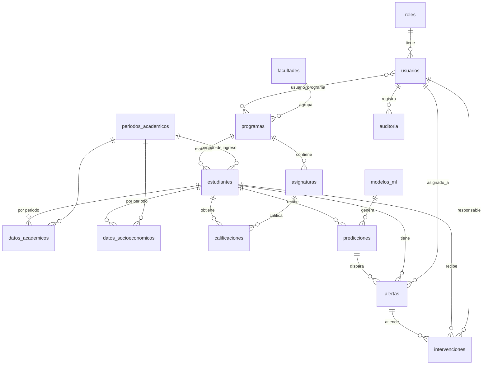

# Base de datos — `desercion_db` (PostgreSQL)

Fase 3.1 (modelo entidad-relación) y 4.2 (implementación). El script `schema.sql` crea **solo la estructura**; los datos los cargan ustedes. Lo único que inserta es el catálogo de **roles** (necesario para crear usuarios).

## Crear la base de datos

```bash
psql -U postgres -c "CREATE DATABASE desercion_db;"
```

```bash
psql -U postgres -d desercion_db -f schema.sql
```

## Orden recomendado para cargar datos

Por las llaves foráneas, insertar en este orden:

1. `facultades` → 2. `programas` → 3. `periodos_academicos` → 4. `usuarios` (el primer administrador se crea con `backend/crear_admin.py`) → 5. `estudiantes` → 6. `datos_socioeconomicos`, `datos_academicos` (y opcionalmente `asignaturas`, `calificaciones`).

`modelos_ml`, `predicciones`, `alertas`, `intervenciones` y `auditoria` los llena el sistema.

## Diagrama entidad-relación



## Tablas y atributos

Convención: **PK** llave primaria · **FK** llave foránea · **UQ** único · *NN* obligatorio.

### roles
| Atributo | Tipo | Restricción | Descripción |
|---|---|---|---|
| id | SERIAL | PK | |
| nombre | VARCHAR(30) | UQ, NN | `administrador`, `coordinador`, `docente`, `bienestar` |
| descripcion | VARCHAR(200) | | |

### usuarios
| Atributo | Tipo | Restricción | Descripción |
|---|---|---|---|
| id | SERIAL | PK | |
| nombres, apellidos | VARCHAR(100) | NN | |
| email | VARCHAR(150) | UQ, NN | Usuario de inicio de sesión |
| password_hash | VARCHAR(255) | NN | Contraseña cifrada con bcrypt |
| rol_id | INTEGER | FK → roles, NN | |
| activo | BOOLEAN | NN | |
| ultimo_acceso, creado_en, actualizado_en | TIMESTAMP | | |

### usuario_programa (N:M)
| Atributo | Tipo | Restricción | Descripción |
|---|---|---|---|
| usuario_id | INTEGER | PK, FK → usuarios | |
| programa_id | INTEGER | PK, FK → programas | Programas que puede ver un coordinador/docente |

### facultades
| Atributo | Tipo | Restricción |
|---|---|---|
| id | SERIAL | PK |
| nombre | VARCHAR(150) | UQ, NN |

### programas
| Atributo | Tipo | Restricción | Descripción |
|---|---|---|---|
| id | SERIAL | PK | |
| facultad_id | INTEGER | FK → facultades, NN | |
| codigo | VARCHAR(20) | UQ, NN | |
| nombre | VARCHAR(150) | NN | |
| nivel | VARCHAR(30) | `tecnico`, `tecnologico`, `pregrado`, `especializacion`, `maestria` | |
| duracion_semestres | SMALLINT | > 0 | |

### periodos_academicos
| Atributo | Tipo | Restricción | Descripción |
|---|---|---|---|
| id | SERIAL | PK | |
| codigo | VARCHAR(10) | UQ, NN | Ej. `2026-1` |
| fecha_inicio, fecha_fin | DATE | NN, fin > inicio | |
| actual | BOOLEAN | | Marca el periodo en curso |

### estudiantes
| Atributo | Tipo | Restricción | Descripción |
|---|---|---|---|
| id | SERIAL | PK | |
| codigo | VARCHAR(20) | UQ, NN | Código estudiantil |
| tipo_documento | VARCHAR(5) | `CC`, `TI`, `CE`, `PA`, `PPT` | |
| numero_documento | VARCHAR(20) | UQ, NN | |
| nombres, apellidos | VARCHAR(100) | NN | |
| fecha_nacimiento | DATE | | Se usa para calcular la edad |
| genero | VARCHAR(15) | `masculino`, `femenino`, `otro` | |
| email, telefono | VARCHAR | | |
| programa_id | INTEGER | FK → programas, NN | |
| periodo_ingreso_id | INTEGER | FK → periodos_academicos | |
| semestre_actual | SMALLINT | 1–14 | |
| puntaje_saber11 | SMALLINT | 0–500 | ICFES |
| tipo_colegio | VARCHAR(10) | `publico`, `privado` | |
| estado | VARCHAR(15) | `activo`, `desertor`, `graduado`, `retirado`, `inactivo` | **Variable objetivo** del modelo (`desertor` = 1) |
| creado_en, actualizado_en | TIMESTAMP | | |

### datos_socioeconomicos (uno por estudiante y periodo)
| Atributo | Tipo | Restricción | Descripción |
|---|---|---|---|
| id | SERIAL | PK | |
| estudiante_id | INTEGER | FK → estudiantes | UQ junto con periodo_id |
| periodo_id | INTEGER | FK → periodos_academicos | |
| estrato | SMALLINT | 0–6 | |
| ingreso_familiar | NUMERIC(12,2) | ≥ 0 | Pesos mensuales |
| trabaja | BOOLEAN | | |
| horas_trabajo_semana | SMALLINT | 0–80 | |
| personas_a_cargo | SMALLINT | ≥ 0 | |
| tipo_vivienda | VARCHAR(15) | `propia`, `arriendo`, `familiar`, `residencia`, `otra` | |
| zona_residencia | VARCHAR(10) | `urbana`, `rural` | |
| distancia_km | NUMERIC(6,2) | ≥ 0 | Distancia a la sede |
| tiene_beca, apoyo_financiero | BOOLEAN | | |
| nivel_educativo_padres | VARCHAR(20) | `ninguno` … `posgrado` | |
| victima_conflicto, pertenece_etnia, discapacidad | BOOLEAN | | Datos sensibles: **no** se usan en el modelo, solo para Bienestar |

### asignaturas
| Atributo | Tipo | Restricción |
|---|---|---|
| id | SERIAL | PK |
| programa_id | INTEGER | FK → programas |
| codigo | VARCHAR(20) | UQ |
| nombre | VARCHAR(150) | NN |
| creditos | SMALLINT | > 0 |
| semestre | SMALLINT | 1–14 |

### datos_academicos (resumen por estudiante y periodo — fuente principal del modelo)
| Atributo | Tipo | Restricción | Descripción |
|---|---|---|---|
| id | SERIAL | PK | |
| estudiante_id | INTEGER | FK → estudiantes | UQ junto con periodo_id |
| periodo_id | INTEGER | FK → periodos_academicos | |
| semestre_cursado | SMALLINT | 1–14 | |
| creditos_inscritos, creditos_aprobados, creditos_reprobados | SMALLINT | ≥ 0 | |
| promedio_periodo, promedio_acumulado | NUMERIC(3,2) | 0–5 | |
| asistencia_pct | NUMERIC(5,2) | 0–100 | |
| materias_reprobadas, materias_canceladas, materias_repetidas | SMALLINT | ≥ 0 | |
| estado_matricula | VARCHAR(15) | `matriculado`, `cancelado`, `aplazado`, `no_matriculado` | |

### calificaciones (opcional)
| Atributo | Tipo | Restricción |
|---|---|---|
| id | SERIAL | PK |
| estudiante_id | FK → estudiantes | UQ (estudiante, asignatura, periodo) |
| asignatura_id | FK → asignaturas | |
| periodo_id | FK → periodos_academicos | |
| nota_final | NUMERIC(3,2) | 0–5 |
| asistencia_pct | NUMERIC(5,2) | 0–100 |
| aprobada | BOOLEAN | |
| intento | SMALLINT | ≥ 1 |

### modelos_ml
| Atributo | Tipo | Descripción |
|---|---|---|
| id | SERIAL PK | |
| nombre, version | VARCHAR | UQ juntos |
| algoritmo | VARCHAR(50) | `random_forest`, `gradient_boosting`, `xgboost`, `lightgbm` |
| ruta_archivo | VARCHAR(255) | Ruta al `.pkl` |
| metricas, hiperparametros, variables | JSONB | |
| fecha_entrenamiento | TIMESTAMP | |
| activo | BOOLEAN | Solo uno activo (índice único parcial) |
| registrado_por | FK → usuarios | |

### predicciones
| Atributo | Tipo | Descripción |
|---|---|---|
| id | SERIAL PK | |
| estudiante_id | FK → estudiantes | |
| periodo_id | FK → periodos_academicos | |
| modelo_id | FK → modelos_ml | |
| probabilidad | NUMERIC(5,4) | 0–1 |
| nivel_riesgo | VARCHAR(10) | `bajo`, `medio`, `alto` |
| factores | JSONB | Factores influyentes `[{variable, valor, impacto}]` |
| creado_por | FK → usuarios | |
| creado_en | TIMESTAMP | |

### alertas
| Atributo | Tipo | Descripción |
|---|---|---|
| id | SERIAL PK | |
| estudiante_id | FK → estudiantes | |
| prediccion_id | FK → predicciones (nullable) | Si la generó el modelo |
| tipo | VARCHAR(20) | `prediccion_ml`, `academica`, `asistencia`, `socioeconomica`, `manual` |
| nivel | VARCHAR(10) | `bajo`, `medio`, `alto` |
| titulo, descripcion | VARCHAR / TEXT | |
| estado | VARCHAR(15) | `pendiente`, `en_proceso`, `atendida`, `cerrada` |
| asignado_a | FK → usuarios | Responsable |
| creado_en, actualizado_en, cerrado_en | TIMESTAMP | |

### intervenciones
| Atributo | Tipo | Descripción |
|---|---|---|
| id | SERIAL PK | |
| estudiante_id | FK → estudiantes | |
| alerta_id | FK → alertas (nullable) | Alerta que atiende |
| responsable_id | FK → usuarios | |
| tipo | VARCHAR(20) | `tutoria`, `psicologica`, `financiera`, `academica`, `familiar`, `seguimiento`, `otra` |
| descripcion, resultado | TEXT | |
| fecha, proxima_fecha | DATE | |
| estado | VARCHAR(15) | `programada`, `realizada`, `cancelada` |

### auditoria
| Atributo | Tipo | Descripción |
|---|---|---|
| id | BIGSERIAL PK | |
| usuario_id | FK → usuarios | |
| accion | VARCHAR(50) | `login`, `crear`, `actualizar`, `predecir`… |
| entidad, entidad_id | | Registro afectado |
| detalle | JSONB | |
| ip | VARCHAR(45) | |
| fecha | TIMESTAMP | |

## Vista `vw_dataset_desercion`

Una fila por estudiante con su **último periodo académico** y los datos socioeconómicos más cercanos. Columna objetivo: `desercion` (1 si `estudiantes.estado = 'desertor'`). La usan tanto el entrenamiento (`ml/`) como el backend al predecir, para que las variables se construyan igual en ambos.

## Relaciones (resumen)

| Relación | Cardinalidad |
|---|---|
| roles → usuarios | 1 : N |
| usuarios ↔ programas | N : M (usuario_programa) |
| facultades → programas | 1 : N |
| programas → estudiantes / asignaturas | 1 : N |
| estudiantes → datos_academicos / datos_socioeconomicos | 1 : N (uno por periodo) |
| estudiantes → predicciones → alertas → intervenciones | 1 : N en cadena |
| modelos_ml → predicciones | 1 : N |
| usuarios → alertas (asignado) / intervenciones (responsable) | 1 : N |
